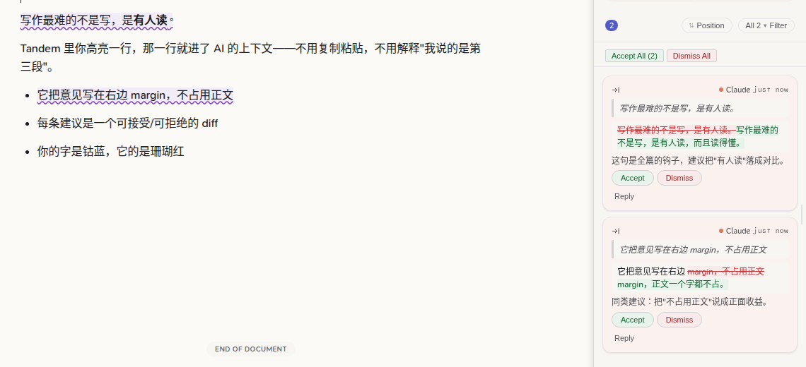
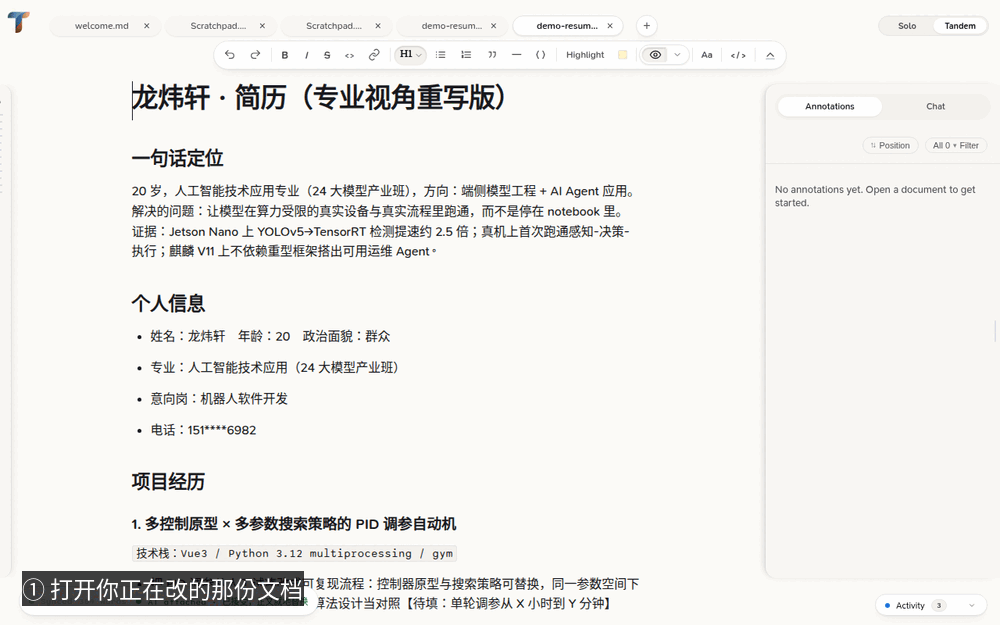

# dsh-tandem-wake

让 [Tandem](https://tandem.ink) 文档里的评论直接唤醒 [DeepSeek Harness](https://github.com/deepseek-ai)（DSH）会话——**你不用回到聊天窗说话**。

Tandem 是一个"你和 AI 共享同一份 Markdown"的编辑器：你在浏览器里改，AI 通过 MCP 改，改动以两种颜色留痕。但它对外的 MCP 是**拉模式**（`tandem_checkInbox`），而 DSH 没有 Claude Code 那种 channel 推送语义。结果就是：你在文档里留了批注，AI 那边永远不知道，除非你切回聊天窗说一句"看我文档"。

这个插件补上这一环：**文档里有新评论 → DSH 会话自己开一轮 → 按你说的改。**



*同一份 Markdown：正文里带下划线的是被批注的区间，右边 margin 是 AI 给出的 diff，人点 Accept / Dismiss 决定去留。*



*完整旅程（约 30 秒）：拖选 → 右键 Annotate → 用中文写要求 → Ctrl+Enter → AI 把 diff 放进 margin → 人点 Accept → 正文当场替换。全程没有切窗口。

[下载 MP4 版](docs/assets/demo-journey.mp4)（更清晰、可暂停）· [Tandem 部署运行指南](docs/TANDEM-SETUP.md)*

## 它怎么工作

```
你在 Tandem 文档里写评论
   ↓  ≤4 s
插件轮询 MCP tandem_checkInbox（本地 HTTP，不产生模型 token）
   ↓  只认 author === 'user' 的批注 / 回复 / 聊天
把「评论原文 + 摘要」拼进一条用户消息
   ↓  agent.followup()   ← next-turn + wakeup:true
DSH 会话自己开一轮，按评论干活
```

## 为什么不是监听 push

Tandem 确实暴露了 `ws://127.0.0.1:3479/api/wake`，插件第一版就是连它。实测**一帧都收不到**：

- 订阅者数一直是 1（连接是活的），但服务器侧 `eventCount` 恒为 0、`lastEventAt` 为 null；
- 读它的源码发现 `CHANNEL_SKIP` 里含 `MCP_ORIGIN`——**Agent 经 MCP 写入的事件整类被跳过**，所以"自己写一条看会不会回推"这种自测根本不成立；
- 批注事件的对外转发还叠了 mode / licence / local-period 三道门。

与其赌哪道门关着，不如走 Tandem 自己文档里写的那条：`checkInbox` *"is the authoritative delivery path"*。

## 三条踩过的坑（复用这个插件前值得知道）

| # | 坑 | 现象 |
|---|---|---|
| 1 | wake socket 不推事件 | 订阅者连着、`eventCount: 0`；`MCP_ORIGIN` 在 `CHANNEL_SKIP` 中 |
| 2 | DSH agent id 带 `session-` 前缀 | `ctx.agents.get('<裸 uuid>')` 返回 undefined，**静默丢弃** |
| 3 | `agent.inject()` 不唤醒 | 它是 `send(input, 'next-step', **false**)`；消息躺进收件箱，等下一次真人说话才被顶出来。要唤醒必须 `followup()`（`next-turn` + `wakeup: true`） |

第 3 条最阴：消息确实进了会话，看起来"发了"，但那一轮永远不会自己开始。

## 在别的宿主里用（没有自动唤醒时）

不是每个宿主都能让插件主动开轮。**Qoder CN** 这类 IDE 插件只能手动取件，所以补一个 `/tandem-wake` 命令：

```bash
qoderclicn mcp add tandem http://127.0.0.1:3479/mcp -t http -s user   # 注册 MCP
cp integrations/qoder-cn/commands/tandem-wake.md ~/.qoder-cn/commands/ # 放命令
```

然后在 Agent 对话框里敲 `/tandem-wake`：它会 `tandem_checkInbox` 取新批注 → 定位区间 → 给建议（不代替人点 Accept）。

细节见 [`integrations/qoder-cn/INSTALL.md`](integrations/qoder-cn/INSTALL.md)。

## 复现"wake 通道是死的"

上面第 1 条不是推测，是量出来的。两个脚本可以直接重跑：

```bash
# 连 /api/wake 听两分钟：能 OPEN，但一帧不落
node tools/wake-probe.mjs 120

# 验证"MCP 写入不产事件"——所以"机器写一条看它回不回推"这种自测本身无效
node tools/mcporigin-selftest.mjs <documentId>
```

## 安装

前提：DSH 已装好，Tandem 正在跑（`tandem` 或桌面版，默认 `http://127.0.0.1:3479`）。

```bash
# 1. 放进一个固定目录
git clone <this repo> ~/.dsh/local/dsh-tandem-wake

# 2. 用 DSH 的 plugin_manager 安装（不要手改 profile）
#    在 DSH 会话里让 agent 执行：
#    plugin_manager(action=install_bundle, target="/home/<you>/.dsh/local/dsh-tandem-wake")
```

然后编辑本包的 `cordis.patch.yml`，把 `sessionId` 换成目标会话的 id——**注意要带 `session-` 前缀**：

```yaml
- insert:
    - id: tandem-wake
      name: '@local/dsh-tandem-wake'
      config:
        mcpUrl: http://127.0.0.1:3479/mcp
        sessionId: session-xxxxxxxx-xxxx-xxxx-xxxx-xxxxxxxxxxxx
        pollMs: 4000
        minIntervalMs: 10000
        maxChars: 400
```

找 id：DSH 会话目录名就是 `session-<uuid>`（`~/.dsh/sessions/<workspace>/`），或者看插件日志里打印的"存活 agent"列表。

## 配置项

| 键 | 默认 | 说明 |
|---|---|---|
| `mcpUrl` | `http://127.0.0.1:3479/mcp` | Tandem 的 MCP HTTP 端点 |
| `sessionId` | 必填 | 目标会话，**带 `session-` 前缀**；填 `auto` 时只有恰好一个存活 agent 才会认领 |
| `pollMs` | `4000` | 轮询间隔 |
| `minIntervalMs` | `10000` | 两次唤醒之间的最小间隔（合并连续评论） |
| `maxChars` | `400` | 注入消息里携带的评论正文字数上限 |

## 观测

所有关键动作追加到 `/tmp/tandem-wake.log`：

```
插件已加载，轮询 http://127.0.0.1:3479/mcp 每 4000ms；目标会话 session-7094…：已解析到（投递用 followup，会主动开轮）
mcp session b03c7064-…
已注入唤醒：· 评论「翻译成德语」…
```

排查顺序：会话是否"已解析到" → 有没有"已注入唤醒" → 有注入但没开轮就是投递方式退化了。

## 已知限制

- **轮询会消耗 `checkInbox` 的未读游标**，所以注入的消息必须自带评论原文；否则唤醒后那一轮再查是空的。
- 只认 `author === 'user'` 的批注/回复/聊天；Agent 自己写的不算。
- 一个实例只唤醒一个会话（`sessionId` 固定）；多会话需要装多份或改造成广播。
- 依赖 Tandem 0.28 的 MCP 工具名；Tandem 升级若改了 `tandem_checkInbox` 的返回结构，需要跟着调。
- 要求 DSH 里有一个可用的 Tandem MCP 连接（`dsh-mcp-client`，`streamable-http` → `http://127.0.0.1:3479/mcp`），插件本身只走 HTTP，不冒充 MCP 客户端给模型加工具。

## 许可

MIT。Tandem 本体是 BUSL-1.1，本仓库不含它的任何代码。
